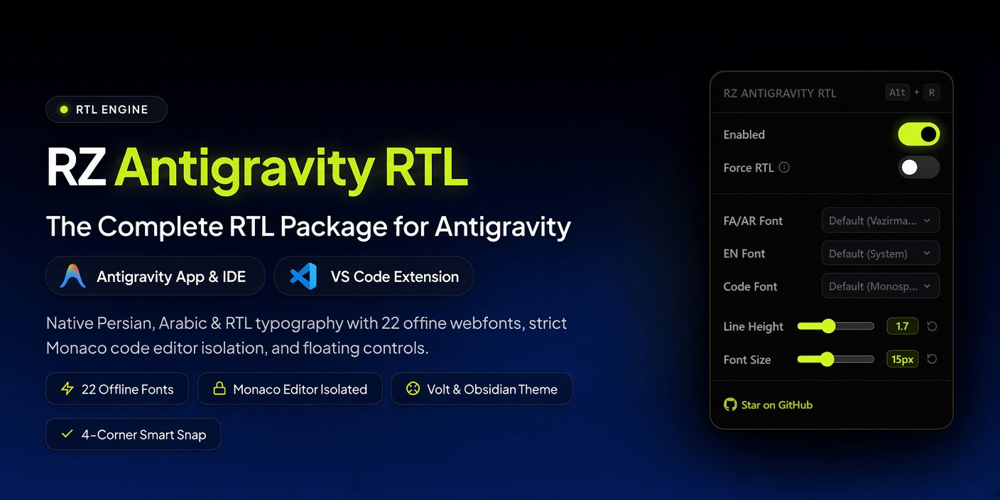

<div align="center">

# RZ Antigravity RTL

**High-Performance Right-to-Left (RTL) Engine & Typography Customizer for Antigravity App, Antigravity IDE & VS Code Extension (Windows & WSL)**

<br/>

<p align="center">
  <a href="README_FA.md">🇮🇷 نسخه فارسی (Persian)</a>
  &nbsp;&nbsp;•&nbsp;&nbsp;
  <a href="README.md">🇬🇧 English Documentation</a>
</p>

<br/>

<p align="center">
  
</p>

<p align="center">
  <a href="https://www.npmjs.com/package/rz-antigravity-rtl"><picture><source media="(prefers-color-scheme: dark)" srcset="https://www.shieldcn.dev/npm/rz-antigravity-rtl.svg?variant=secondary&amp;size=sm&amp;mode=dark&amp;font=fira-code"></picture></a>
  &nbsp;
  <a href="https://www.npmjs.com/package/rz-antigravity-rtl"><picture><source media="(prefers-color-scheme: dark)" srcset="https://www.shieldcn.dev/npm/dt/rz-antigravity-rtl.svg?variant=secondary&amp;size=sm&amp;mode=dark&amp;font=fira-code"></picture></a>
  &nbsp;
  <a href="https://github.com/rezasalimi01/rz-antigravity-rtl"><picture><source media="(prefers-color-scheme: dark)" srcset="https://www.shieldcn.dev/github/stars/rezasalimi01/rz-antigravity-rtl.svg?variant=secondary&amp;size=sm&amp;mode=dark&amp;font=fira-code"></picture></a>
  &nbsp;
  <a href="https://github.com/rezasalimi01/rz-antigravity-rtl"><picture><source media="(prefers-color-scheme: dark)" srcset="https://www.shieldcn.dev/github/last-commit/rezasalimi01/rz-antigravity-rtl.svg?variant=secondary&amp;size=sm&amp;mode=dark&amp;font=fira-code"></picture></a>
</p>

</div>

---

A smart, automated CLI patcher bringing native-feeling Persian (Farsi), Arabic, Hebrew, and RTL support to Google Antigravity applications (**Desktop App**, **Antigravity IDE**, and the official **Google Antigravity extension for VS Code / VS Code Insiders**, across both **Windows** and **WSL** remote environments, as well as **standalone web browser views**).

Features an advanced bidirectional text engine, 22 curated offline webfonts, strict Monaco code editor isolation, and an interactive floating UI to configure typography and layout settings on the fly.

---

## ✨ Features

- **Full Multi-Environment Coverage**:
  - **Antigravity Desktop App**: Direct ASAR patching with clean automatic backups.
  - **Antigravity IDE**: Patches both the main workbench and extension host.
  - **VS Code Extension**: Full support for Google Antigravity extension across VS Code and VS Code Insiders.
  - **WSL Remote Support**: Seamlessly discovers and patches Linux WSL instances (`~/.antigravity-ide-server` and `~/.vscode-server`).
  - **Web Browser Support**: Automatically detects and applies typography and direction in web-based sessions (`http://127.0.0.1:<port>/c/...`).
- **Smart Bi-Directional Engine (BidiLens-Inspired)**:
  - **Code-Snippet Isolation**: Inline code tags (`code`, `pre`, `kbd`, `samp`, `var`, `svg`) are extracted before calculating element direction, ensuring sentences and list items remain properly right-aligned even when containing multiple English identifiers.
  - **Technical Token Detection**: Strips kebab-case names, file paths, URLs, shell commands, and CSS selectors before analyzing prose.
  - **Instant Fast-Path**: Purely English messages and code blocks exit in `0.001ms` with near-zero CPU footprint.
- **Strict Code Editor Isolation**: Only the chat interface (messages, prompt inputs, interactive questions) is RTL-enabled. The Monaco editor, code blocks, terminal, and file explorer remain strictly LTR and untouched.
- **Seamless Topbar & Mentions UI**:
  - The **RZ RTL** toggle sits right between the three-dots menu and the Open IDE button with native margin alignment.
  - File/folder mentions (`@file`, `@folder`) preserve their original LTR character sequence with baseline-aligned icons.
- **Curated 22 Offline Webfonts**:
  - **Persian**: Vazirmatn (Default), IRANSans X, IRANYekanX Pro, Kalameh, Noora, Pelak, Ravi, Yekan Bakh.
  - **English**: System (Default), Open Sans, Roboto, Fira Sans.
  - **Code**: Monospace (Default), Fira Code, JetBrains Mono.
- **Interactive Floating & Topbar Settings Panel**:
  - Live numeric Line Height & Font Size sliders.
  - Draggable with 4-corner snap restricted safely to the chat pane.
  - Keyboard shortcut: `Alt + R` (Windows/Linux) or `⌥R` (macOS).
- **Persian Keyboard Optimization**: Maps `Shift + 2` to type `@` instead of `٬` in chat input fields.
- **Automated Backup & Instant Restore**: Automatic safe backups created prior to patching, with a zero-friction `--restore` flag.

---

## 🚀 Installation & Quick Start

You don't need to manually configure or extract any files. Run the following command in your terminal:

```bash
npx rz-antigravity-rtl
```

An interactive menu will detect your installed applications and let you choose:
1. **All Applications (Desktop, IDE, VS Code & WSL) [Recommended]**
2. **Antigravity Desktop App only**
3. **Antigravity IDE only (Windows & WSL)**
4. **VS Code Antigravity Extension only (Windows & WSL)**
5. **WSL environments only**

### Command-Line Options

```bash
# Patch all installed environments (Desktop, IDE, VS Code & WSL)
npx rz-antigravity-rtl --all

# Patch only WSL remote environments (Antigravity IDE Server & VS Code Server)
npx rz-antigravity-rtl --wsl

# Patch only Antigravity IDE (Windows & WSL)
npx rz-antigravity-rtl --ide

# Patch only VS Code Extension (Windows & WSL)
npx rz-antigravity-rtl --vscode

# Patch only Antigravity Desktop App
npx rz-antigravity-rtl --app

# Restore original unpatched files
npx rz-antigravity-rtl --restore
npx rz-antigravity-rtl --wsl --restore
npx rz-antigravity-rtl --ide --restore
npx rz-antigravity-rtl --vscode --restore
npx rz-antigravity-rtl --app --restore
```

### Platform-Specific Notes

#### Windows
Run in **PowerShell** or **Command Prompt**:
```powershell
npx rz-antigravity-rtl
```

#### Linux & WSL
```bash
npx rz-antigravity-rtl
```
*(If modifying system-level directories, prefix with `sudo`)*

#### macOS
```bash
sudo npx rz-antigravity-rtl
```

> [!WARNING]
> **Application Updates:** When Antigravity or VS Code updates, upstream files are overwritten. Simply run `npx rz-antigravity-rtl --all` once after an update to re-apply the patch.

---

## 📚 Technical Documentation

For detailed architecture diagrams and implementation internals, check out the [`docs/`](./docs/) directory:

- [**Architecture Overview**](./docs/architecture.md) — ASAR extraction, patching pipeline, and injection anchors.
- [**Antigravity IDE Integration**](./docs/ide-integration.md) — CSP bypassing, workbench injection, and Monaco editor isolation.
- [**Antigravity App Integration**](./docs/desktop-integration.md) — Electron IPC bridge and `dist/utils.js` injection.
- [**UI System & Micro-Animations**](./docs/ui-system.md) — Spring dropdowns, drag-and-snap mathematics, and responsive design.
- [**Typography & Offline Fonts**](./docs/typography-fonts.md) — Base64 embedding, unicode range subsetting, and auto-direction regex.

---

## 📊 Analytics & Activity

<p align="center">
  <a href="https://www.npmjs.com/package/rz-antigravity-rtl">
    
  </a>
</p>

<p align="center">
  <a href="https://github.com/rezasalimi01/rz-antigravity-rtl">
    
  </a>
</p>

---

## 👥 Contributors

<p align="center">
  <a href="https://github.com/rezasalimi01/rz-antigravity-rtl/graphs/contributors">
    
  </a>
</p>

---

## 🌟 Acknowledgements & Credits

- Based initially on [antigravity-rtl](https://github.com/mmnaderi/antigravity-rtl) by [mmnaderi](https://github.com/mmnaderi).
- Direction detection and inline code-isolation algorithms inspired by [BidiLens](https://github.com/CodeinScrubs/BidiLens).
