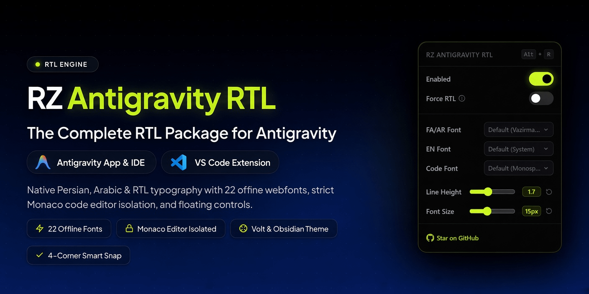

# RZ Antigravity RTL — RTL Support for Antigravity App, Antigravity IDE & VS Code Extension

<p align="center">
  
</p>

[](https://www.npmjs.com/package/rz-antigravity-rtl)
[](https://www.npmjs.com/package/rz-antigravity-rtl)
[](https://github.com/rezasalimi01/rz-antigravity-rtl)
[](https://opensource.org/licenses/MIT)

> **Antigravity RTL**: High-performance Right-to-Left (RTL) engine and typography customizer for **Antigravity App**, **Antigravity IDE**, and the **VS Code Extension**.

A smart, automated CLI patcher bringing native-feeling Persian (Farsi), Arabic, Hebrew, and RTL support to Google Antigravity applications (Desktop, Antigravity IDE, and the official Google Antigravity extension for VS Code / VS Code Insiders). Features 22 curated offline webfonts, strict Monaco code editor isolation, and an interactive floating UI to configure fonts, line heights, font sizes, and behavior on the fly.

---

## ✨ Features

- **Triple Support**: Seamlessly patches **Antigravity App**, **Antigravity IDE**, and the official **VS Code Google Antigravity Extension** (`google.google-antigravity-*` in both VS Code and VS Code Insiders).
- **Strict Code Editor Isolation**: In Antigravity IDE and VS Code, only the chat panel (`antigravity-agent-side-panel`, inputs, and questions) is RTL-patched. The Monaco code editor, file explorer, status bar, and code blocks (`<pre>`, `<code>`) remain strictly LTR and untouched!
- **Full Chat Typography Coverage**: Custom Persian, English, and Code fonts apply cleanly across the entire chat experience — user/agent messages, prompt input editor, action buttons, tool execution cards, and subagent status badges.
- **Neon Volt & Pitch Black Theme**: Modern obsidian & pitch black design (`#000000`) with vibrant electric lime accents (`#D0FE1B`) for maximum visual contrast and readability.
- **Fluid UI & Custom Spring Dropdowns**: Custom animated dropdown menus that open with smooth spring physics instead of rigid native OS selects.
- **Micro-Animations & Auto-Reset**: Live slider numbers pulse with a responsive micro-animation when dragging and automatically return to their rest state after 300ms.
- **Draggable with 4-Corner Snap (Strictly Confined to Chat)**: Drag the floating settings button anywhere within the chat panel to snap intelligently to any of the 4 inner corners, never escaping into the Monaco editor or rest of IDE.
- **22 Curated Offline Fonts**: Built-in dropdowns to easily pick between curated offline webfonts:
  - **Persian**: Default (Vazirmatn), IRANSans X, IRANYekanX Pro, Kalameh, Noora, Pelak, Ravi, Yekan Bakh
  - **English**: Default (System), Open Sans, Roboto, Fira Sans
  - **Code**: Default (Monospace), Fira Code, JetBrains Mono
- **Live Numeric Sliders**: Interactive Line Height and Font Size sliders with real-time numeric value displays and one-click reset buttons.
- **Smart Auto-Direction**: Automatically detects if a paragraph begins with RTL or LTR characters and aligns it accordingly.
- **Force RTL Mode**: Toggle switch to force all chat output to align to the right regardless of character detection.
- **Persian Keyboard Fix**: Maps `Shift + 2` to type `@` instead of `٬` on Persian keyboards.
- **Auto-Cleanup & Zero Conflicts**: Automatically detects and purges any previous or third-party RTL patches (including original `antigravity-rtl` patches, old global packages, and legacy files) to guarantee clean, collision-free operation.
- **Safe Backups & Restore**: Automatic backups created prior to patching, with an instant `--restore` command.

---

## 🚀 Installation & Quick Start

You don't need to manually configure or extract any files. Just run the following command in your terminal:

```bash
npx rz-antigravity-rtl
```

An interactive menu will detect your installed applications and let you choose:
1. **All Applications (Desktop, IDE & VS Code Extension) [Recommended]**
2. **Antigravity App App only**
3. **Antigravity IDE only**
4. **VS Code Antigravity Extension only**

### Command-Line Flags

```bash
# Patch all installed applications automatically (Desktop, IDE & VS Code Extension)
npx rz-antigravity-rtl --all

# Patch only the VS Code Extension (VS Code / VS Code Insiders)
npx rz-antigravity-rtl --vscode
# or alias: npx rz-antigravity-rtl --ext

# Patch only Antigravity IDE
npx rz-antigravity-rtl --ide

# Patch only Antigravity App
npx rz-antigravity-rtl --app

# Restore original unpatched files
npx rz-antigravity-rtl --restore
npx rz-antigravity-rtl --vscode --restore
npx rz-antigravity-rtl --ide --restore
npx rz-antigravity-rtl --app --restore
```

### OS Specific Notes

#### Windows
Run **PowerShell** or **Command Prompt**:
```powershell
npx rz-antigravity-rtl
```

#### macOS
```bash
sudo npx rz-antigravity-rtl
```
> **macOS Users:** If you receive a "Permission Denied" error, ensure your terminal has **App Management** permissions in `System Settings > Privacy & Security > App Management`.

#### Linux
```bash
sudo npx rz-antigravity-rtl
```

> [!WARNING]
> **App Updates:** Since official updates to Antigravity, Antigravity IDE, or the VS Code extension overwrite application files, you will need to re-run `npx rz-antigravity-rtl` after an update to re-apply the patch.

---

## 📚 In-Depth Documentation

For detailed technical explanations, architecture diagrams, and developer guides, explore the [`docs/`](./docs/) directory:

- [**Architecture Overview**](./docs/architecture.md) — How the patcher works, ASAR extraction/repacking, and injection anchors.
- [**Antigravity IDE Integration**](./docs/ide-integration.md) — CSP bypassing, workbench injection, and Monaco editor isolation.
- [**Antigravity App Integration**](./docs/desktop-integration.md) — Desktop Electron architecture, `dist/utils.js`, and IPC bridge.
- [**UI System & Micro-Animations**](./docs/ui-system.md) — Color palette, spring physics, 4-corner snap mathematics, and debounce timers.
- [**Typography & Offline Fonts**](./docs/typography-fonts.md) — Base64 vs local font loading, unicode range subsetting, and auto-direction regex.

---

## Credits & Acknowledgements

This project is an advanced fork and evolution of the original [**antigravity-rtl**](https://github.com/mmnaderi/antigravity-rtl) created by [**Mohammad Mehdi Naderi (mmnaderi)**](https://github.com/mmnaderi). Special thanks to the original creator for the initial concept and foundation.

---

<div dir="rtl">

# ابزار هوشمند RZ Antigravity RTL — پشتیبانی راست‌به‌چپ برای Antigravity App، Antigravity IDE و اکستنشن VS Code

> **پشتیبانی کامل از Antigravity App، Antigravity IDE و اکستنشن رسمی VS Code**: موتور هوشمند راست‌به‌چپ و شخصی‌سازی تایپوگرافی برای تمامی محیط‌های آنتی‌گرویتی.

یک پچِ هوشمند، بسیار سریع و زیبا برای پشتیبانی کامل از زبان‌های راست‌به‌چپ (RTL) در برنامه‌های **Antigravity App**، **Antigravity IDE** و همچنین **اکستنشن رسمی Google Antigravity در VS Code (و نسخه Insiders)**.

این ابزار خط فرمان (CLI) به صورت خودکار موتور پیشرفتهٔ RTL را به هستهٔ برنامه و محیط چت آنتی‌گرویتی تزریق می‌کند تا از زبان‌های فارسی، عربی و عبری به بهترین شکل پشتیبانی شود و یک پنل شناور با نام **RZ Antigravity RTL** برای تغییر زندهٔ فونت‌ها، اندازهٔ خطوط و قلم در اختیار شما قرار می‌دهد.

## ✨ امکانات برجسته

- **پشتیبانی سه‌گانه (Triple Support)**: قابل اعمال روی نسخه دسکتاپ، محیط مستقل Antigravity IDE و اکستنشن رسمی Google Antigravity در نرم‌افزار VS Code.
- **ایزوله بودن کامل ادیتور کد در IDE و VS Code**: محیط کدنویسی اصلی (Monaco Editor)، درخت فایل‌ها، تب‌ها، منوها، ترمینال و بلوک‌های کد (`pre` و `code`) کاملاً دست‌نخورده و چپ‌چین می‌مانند و تنظیمات تنها در سراسر محیط چت (پیام‌ها، فیلد ورودی پرامپت، دکمه‌ها و کارت‌های ابزار) اعمال می‌شود.
- **پوشش کامل تایپوگرافی چت**: فونت‌های فارسی، انگلیسی و کدنویسی روی تمام اجزای محیط گفتگو (متن پیام‌ها، ویرایشگر پرامپت، کارت‌های اجرای ابزار و نشان‌های وضعیت ساب‌ایجنت‌ها) به صورت یکپارچه اعمال می‌شوند.
- **ترکیب رنگی نئون لایم و مشکی عمیق**: تم مدرن مشکی خالص (`#000000`) با لهجه‌های جذاب سبز-فسفری/لایم نئون (`#D0FE1B`) برای کنتراست فوق‌العاده و زیبایی چشم‌نواز.
- **رابط کاربری نرم و دراپ‌داون‌های فنری انیمیشنی**: باز شدن دراپ‌داون‌ها با فیزیک اسپرینگ (فنری) نرم و مدرن به جای سلکتورهای ساده و خشک پیش‌فرض سیستم‌عامل.
- **میکرو-انیمیشن‌ها و برگشت خودکار**: تغییر اسلایدرها همراه با پالس و میکروانیمیشن مقادیر عددی است که پس از توقف دست به صورت خودکار به حالت عادی بازمی‌گردد.
- **درگ و اسنپ هوشمند به ۴ گوشه (کاملاً ایزوله در باکس چت)**: در Antigravity IDE و VS Code، دکمه تنها در محدودهٔ داخلی باکس چت حرکت می‌کند و به هیچ وجه وارد محیط ادیتور کد یا سایر بخش‌ها نمی‌شود و به ۴ گوشهٔ داخلی باکس اسنپ می‌شود.
- **دراپ‌داون اختصاصی انتخاب ۲۲ فونت‌ آفلاین**:
  - **فارسی**: پیش‌فرض (Vazirmatn)، ایران سنس ایکس (IRANSans X)، ایران یکان ایکس (IRANYekanX Pro)، کلمه (Kalameh)، نورا (Noora)، پلاک (Pelak)، راوی (Ravi)، یکان بخ (Yekan Bakh)
  - **انگلیسی**: پیش‌فرض (System)، اوپن سنس (Open Sans)، روبوتو (Roboto)، فیرا سنس (Fira Sans)
  - **کد نویسی**: پیش‌فرض (Monospace)، فیرا کد (Fira Code)، جت‌برینز مونو (JetBrains Mono)
- **نمایش عددی زنده برای اسلایدرها**: نمایش عدد دقیق Line Height و Font Size در کنار اسلایدرها به همراه دکمه‌های ریست سریع.
- **راست‌چین هوشمند (Smart Auto-Direction)**: سیستم به صورت خودکار تشخیص می‌دهد که هر پیام با حرف فارسی شروع شده یا انگلیسی و جهت آن را تنظیم می‌کند.
- **حالت راست‌چینِ اجباری (Force RTL Mode)**: قابلیت سوئیچ برای راست‌چین کردن تمام پیام‌های چت.
- **اصلاح کیبورد فارسی**: رفع مشکل کلید `Shift + 2` برای تایپ علامت `@` به جای «٬».
- **پاکسازی خودکار و عدم تداخل (Auto-Cleanup & Zero Conflicts)**: شناسایی و پاکسازی خودکار هرگونه پچ قبلی (مانند سورس اصلی antigravity-rtl، پکیج‌های منسوخ گلوبال و فایل‌های قدیمی) قبل از نصب پچ جدید جهت جلوگیری از هرگونه تداخل.
- **بازگردانی امن (Restore)**: تهیه بک‌آپ خودکار و بازگردانی سریع به حالت پیش‌فرض با فلگ `--restore`.

## 🚀 نحوهٔ استفاده

برای اجرا کافیست دستور زیر را در ترمینال وارد کنید:

```bash
npx rz-antigravity-rtl
```

ابزار به صورت خودکار برنامه‌های نصب‌شده روی سیستم شما را شناسایی کرده و منوی زیر را نمایش می‌دهد:
1. **All Applications (Desktop, IDE & VS Code Extension) [Recommended]**
2. **Antigravity App App only**
3. **Antigravity IDE only**
4. **VS Code Antigravity Extension only**

### گزینه‌های خط فرمان

```bash
# پچ کردن هم‌زمان همه برنامه‌ها (دسکتاپ، IDE و اکستنشن VS Code)
npx rz-antigravity-rtl --all

# پچ کردن فقط اکستنشن رسمی VS Code
npx rz-antigravity-rtl --vscode

# پچ کردن فقط محیط Antigravity IDE
npx rz-antigravity-rtl --ide

# پچ کردن فقط برنامه Antigravity دسکتاپ
npx rz-antigravity-rtl --app

# بازگردانی به نسخه اصلی (حذف پچ)
npx rz-antigravity-rtl --restore
npx rz-antigravity-rtl --vscode --restore
npx rz-antigravity-rtl --ide --restore
npx rz-antigravity-rtl --app --restore
```

---

## قدردانی و سورس اصلی (Credits)

این پروژه بر پایه سورس اولیه [**antigravity-rtl**](https://github.com/mmnaderi/antigravity-rtl) اثر **محمد مهدی نادری (mmnaderi)** بازطراحی و توسعه یافته است. با تشکر از ایشان بابت ایده و زیرساخت ابتدایی این ابزار.

---

</div>

## 📄 License

This project is licensed under the [MIT License](LICENSE).
