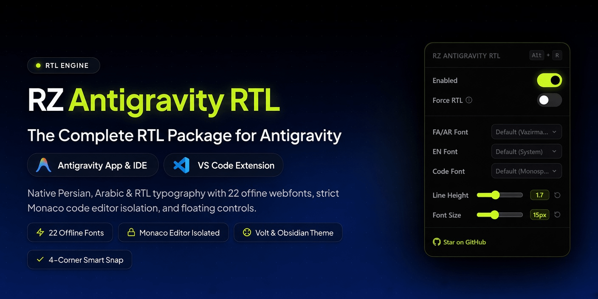

<div dir="rtl" align="center">

# ابزار هوشمند RZ Antigravity RTL

**موتور قدرتمند راست‌به‌چپ (RTL) و شخصی‌سازی تایپوگرافی برای Antigravity App، Antigravity IDE و اکستنشن VS Code (ویندوز و WSL)**

<br/>

<p align="center">
  <a href="README.md">🇬🇧 English Documentation</a>
  &nbsp;&nbsp;•&nbsp;&nbsp;
  <a href="README_FA.md">🇮🇷 نسخه فارسی</a>
</p>

<br/>

<p align="center">
  
</p>

<p align="center">
  <a href="https://www.npmjs.com/package/rz-antigravity-rtl"><picture><source media="(prefers-color-scheme: dark)" srcset="https://www.shieldcn.dev/npm/rz-antigravity-rtl.svg?variant=secondary&amp;size=sm&amp;mode=dark&amp;font=fira-code"></picture></a>
  &nbsp;
  <a href="https://www.npmjs.com/package/rz-antigravity-rtl"><picture><source media="(prefers-color-scheme: dark)" srcset="https://www.shieldcn.dev/npm/dt/rz-antigravity-rtl.svg?variant=secondary&amp;size=sm&amp;mode=dark&amp;font=fira-code"></picture></a>
  &nbsp;
  <a href="https://github.com/rezasalimi01/rz-antigravity-rtl"><picture><source media="(prefers-color-scheme: dark)" srcset="https://www.shieldcn.dev/github/stars/rezasalimi01/rz-antigravity-rtl.svg?variant=secondary&amp;size=sm&amp;mode=dark&amp;font=fira-code"></picture></a>
  &nbsp;
  <a href="https://github.com/rezasalimi01/rz-antigravity-rtl"><picture><source media="(prefers-color-scheme: dark)" srcset="https://www.shieldcn.dev/github/last-commit/rezasalimi01/rz-antigravity-rtl.svg?variant=secondary&amp;size=sm&amp;mode=dark&amp;font=fira-code"></picture></a>
</p>

</div>

---

<div dir="rtl">

یک پچِ هوشمند، بسیار سریع و زیبا بر پایه خط فرمان (CLI) برای پشتیبانی بومی و همه‌جانبه از زبان‌های فارسی، عربی و عبری در برنامه‌های **Antigravity App**، محیط یکپارچه **Antigravity IDE** و همچنین **اکستنشن رسمی Google Antigravity در VS Code (و نسخه Insiders)** هم در ویندوز و هم سرورهای لینوکسی **WSL Remote** و **صفحات وب چت**.

این ابزار به صورت خودکار موتور هوشمند راست‌به‌چپ را همراه با ۲۲ فونت آفلاین فارسی، انگلیسی و کدنویسی به هسته برنامه تزریق می‌کند و یک پنل زیبا و مدرن با تم مشکی و نئون لایم برای تغییر فونت، سایز قلم و ارتفاع خطوط به صورت زنده در اختیارتان می‌گذارد.

---

## ✨ امکانات و قابلیت‌های برجسته

- **پشتیبانی سراسری از تمام محیط‌ها**:
  - **Antigravity Desktop App**: پچ مستقیم پکیج ASAR به همراه بک‌آپ خودکار و ایمن.
  - **Antigravity IDE**: پچ همزمان رابط کاربری Workbench و Extension Host.
  - **اکستنشن VS Code**: سازگاری کامل با اکستنشن رسمی در VS Code و VS Code Insiders.
  - **پشتیبانی یکپارچه از WSL**: شناسایی و پچ خودکار سرورهای لینوکس WSL (`~/.antigravity-ide-server` و `~/.vscode-server`).
  - **پشتیبانی از مرورگر وب**: اعمال خودکار فونت و راست‌چین در تب‌های وب چت مستقیم (`http://127.0.0.1:<port>/c/...`).
- **موتور هوشمند دوجهته (با الهام از BidiLens)**:
  - **ایزوله‌سازی کدهای متنی**: تگ‌های کد (`code`, `pre`, `kbd`, `samp`, `var`, `svg`) پیش از محاسبه جهت استخراج می‌شوند تا حضور چند واژه انگلیسی یا نام متغیر داخل بک‌تیک هرگز باعث چپ‌چین شدن پاراگراف یا لیست‌های فارسی نشود.
  - **تشخیص شناسه‌های فنی**: نام‌های Kebab-case (مانند `user-message-content`)، مسیرهای فایل، URLها و دستورات شل از محاسبات زبان طبیعی تفکیک می‌شوند.
  - **خروج زودهنگام و فوق‌سریع (Fast-Path)**: متون و کدهای ۱۰۰٪ انگلیسی در کسری از میلی‌ثانیه (`0.001ms`) و بدون مصرف CPU با جهت چپ‌به‌راست تعیین تکلیف می‌شوند.
- **ایزوله بودن کامل ادیتور کد (Monaco Editor)**: تنها محیط گفتگو و اینپوت پیام‌ها راست‌چین می‌شود. ادیتور کد اصلی، درخت فایل‌ها، تب‌ها و ترمینال کاملاً دست‌نخورده و چپ‌چین می‌مانند.
- **رابط کاربری شکیل نوار بالا و منشن‌های فایل**:
  - دکمه **RZ RTL** دقیقاً در کنار سه نقطه و دکمه Open IDE با فاصله‌گذاری استاندارد قرار می‌گیرد.
  - منشن‌های فایل و فولدر (`@file`, `@folder`) ساختار LTR حروف و آیکون تراز شده خود را حفظ می‌کنند.
- **۲۲ قلم وب‌فونت آفلاین و پرطرفدار**:
  - **فارسی**: پیش‌فرض (Vazirmatn)، ایران‌سنس ایکس (IRANSans X)، ایران‌یکان ایکس پرو (IRANYekanX Pro)، کلمه (Kalameh)، نورا (Noora)، پلاک (Pelak)، راوی (Ravi)، یکان‌بخ (Yekan Bakh).
  - **انگلیسی**: پیش‌فرض (System)، اوپن‌سنس (Open Sans)، روبوتو (Roboto)، فیرا‌سنس (Fira Sans).
  - **کدنویسی**: پیش‌فرض (Monospace)، فیراکد (Fira Code)، جت‌برینز مونو (JetBrains Mono).
- **پنل شناور و نوار بالای تعاملی**:
  - اسلایدرهای عددی زنده برای تغییر اندازه قلم (Font Size) و فاصله خطوط (Line Height).
  - درگ و اسنپ به ۴ گوشه با محدودیت امن در محدوده باکس چت.
  - کلید میانبر تغییر وضعیت: `Alt + R` در ویندوز/لینوکس یا `⌥R` در مک.
- **بهینه‌سازی کیبورد فارسی**: تبدیل خودکار `Shift + 2` به کاراکتر `@` به جای `٬` در ورودی پرامپت چت.
- **پشتیبان‌گیری خودکار و بازیابی درجا**: ایجاد بک‌آپ تمیز قبل از اعمال تغییرات با امکان ریستور سریع با فلگ `--restore`.

---

## 🚀 نصب و اجرای سریع

نیازی به تنظیم دستی یا اکسترکت کردن فایل‌ها ندارید. کافیست دستور زیر را در ترمینال خود اجرا فرمایید:

```bash
npx rz-antigravity-rtl
```

منوی تعاملی به صورت خودکار برنامه‌های نصب‌شده شما را شناسایی کرده و گزینه‌های زیر را در اختیارتان می‌گذارد:
1. **تمام برنامه‌ها (Desktop, IDE, VS Code & WSL) [پیشنهادی]**
2. **فقط نسخه دسکتاپ Antigravity App**
3. **فقط Antigravity IDE (ویندوز و WSL)**
4. **فقط اکستنشن VS Code (ویندوز و WSL)**
5. **فقط محیط‌های ریموت WSL**

### پارامترها و فلگ‌های خط فرمان (CLI Flags)

```bash
# پچ کردن خودکار تمامی محیط‌های نصب شده (دسکتاپ، IDE، اکستنشن و WSL)
npx rz-antigravity-rtl --all

# پچ کردن سرورهای لینوکسی WSL (سرور Antigravity IDE و VS Code Server)
npx rz-antigravity-rtl --wsl

# پچ کردن Antigravity IDE (ویندوز و WSL)
npx rz-antigravity-rtl --ide

# پچ کردن اکستنشن VS Code (ویندوز و WSL)
npx rz-antigravity-rtl --vscode

# پچ کردن نسخه دسکتاپ Antigravity Desktop App
npx rz-antigravity-rtl --app

# بازگردانی فایل‌های اصلی و پاکسازی کامل پچ (Restore)
npx rz-antigravity-rtl --restore
npx rz-antigravity-rtl --wsl --restore
npx rz-antigravity-rtl --ide --restore
npx rz-antigravity-rtl --vscode --restore
npx rz-antigravity-rtl --app --restore
```

### نکات سیستم‌عامل‌ها

#### ویندوز
در **PowerShell** یا **Command Prompt**:
```powershell
npx rz-antigravity-rtl
```

#### لینوکس و WSL
```bash
npx rz-antigravity-rtl
```
*(در صورت نیاز به دسترسی فایل‌های سیستمی از `sudo` استفاده کنید)*

#### مک (macOS)
```bash
sudo npx rz-antigravity-rtl
```

> [!WARNING]
> **به‌روزرسانی‌های نرم‌افزار:** هنگامی که نرم‌افزار Antigravity یا VS Code آپدیت رسمی دریافت می‌کند، فایل‌های اصلی برنامه بازنویسی می‌شوند. پس از هر آپدیت کافیست یک‌بار دستور `npx rz-antigravity-rtl --all` را اجرا نمایید تا پچ مجدداً فعال گردد.

---

## 📚 مستندات فنی و ساختار معماری

برای مطالعه سازوکار فنی، نحوه بای‌پس CSP، لاجیک اسنپ دکمه و ایزوله‌سازی کدها به پوشه [`docs/`](./docs/) مراجعه فرمایید:

- [**معماری کلی سیستم (Architecture Overview)**](./docs/architecture.md) — فرآیند پچ ASAR و نقاط تزریق کد.
- [**سازگاری با Antigravity IDE**](./docs/ide-integration.md) — تزریق به محیط Workbench و ایزوله‌سازی ادیتور موناکو.
- [**سازگاری با نسخه Desktop App**](./docs/desktop-integration.md) — پل ارتباطی Electron IPC و فایل `dist/utils.js`.
- [**سیستم رابط کاربری و انیمیشن‌ها**](./docs/ui-system.md) — دراپ‌داون‌های فنری و فیزیک حرکت دکمه.
- [**تایپوگرافی و فونت‌های آفلاین**](./docs/typography-fonts.md) — ساختار Base64، یونیکد رنج‌ها و ریجکس‌های تشخیص متن.

---

## 📊 آمار و نمودارهای فعالیت

<p align="center">
  <a href="https://www.npmjs.com/package/rz-antigravity-rtl">
    
  </a>
</p>

<p align="center">
  <a href="https://github.com/rezasalimi01/rz-antigravity-rtl">
    
  </a>
</p>

---

## 👥 مشارکت‌کنندگان (Contributors)

<p align="center">
  <a href="https://github.com/rezasalimi01/rz-antigravity-rtl/graphs/contributors">
    
  </a>
</p>

---

## 🌟 قدردانی و سورس‌های مرتبط (Credits)

- بر پایه سورس اولیه [antigravity-rtl](https://github.com/mmnaderi/antigravity-rtl) اثر [mmnaderi](https://github.com/mmnaderi).
- الگوریتم تشخیص جهت و ایزوله‌سازی کدهای متنی با الهام از [BidiLens](https://github.com/CodeinScrubs/BidiLens).

</div>
